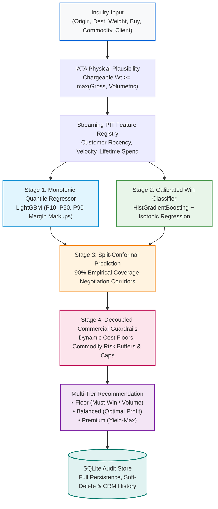

<div align="center">

# ✈️ Air Export Pricing Recommendation Engine
### *Enterprise ML Margin Optimization • Conformal Negotiation Corridors • Hard Commercial Guardrails*

[](https://www.python.org/)
[-2ea44f?style=for-the-badge&logo=pytest&logoColor=white)](tests/)
[](src/engine_v3.py)
[](src/engine_v3.py)
[](Dockerfile)
[](README.md)

<p align="center">
  <b>A real-time commercial decision platform built for international air freight forwarders.</b><br>
  Replaces static tariff markups and manual manager escalations with data-driven clearing prices, guaranteed negotiation bandwidth, and hard profitability safeguards.
</p>

---

</div>

## 🌟 Why Air Cargo Pricing Engine V3?

Traditional air freight pricing relies on static spreadsheets, rule-of-thumb percentages, or lengthy manager escalation queues. This causes **margin leakage on high-frequency lanes**, **sub-cost bids on volatile airline rates**, and **lost bookings due to delayed quotes**.

**Pricing Engine V3** solves this with a mathematically rigorous, low-latency decision stack:

| Core Value | Commercial Benefit | Operational Mechanism |
| :--- | :--- | :--- |
| 🎯 **Dynamic Margin Optimization** | Maximizes expected profit per inquiry | Tri-quantile Gradient Boosted Decision Trees ($P_{10}, P_{50}, P_{90}$) model real market clearing curves. |
| 🛡️ **Zero Margin Leakage** | Never quote below true operational breakeven | Deterministic cost floors incorporate IATA chargeable physics, AWB document fees, and handling floors. |
| 🤝 **Pre-Approved Sales Latitude** | Closes deals on the phone without escalation | Split-Conformal Prediction Corridors deliver 90% empirical confidence bands $[X\%, Y\%]$. |
| ⚡ **Sub-15ms Live Serving** | Real-time pricing for TMS & web booking | Pre-computed $O(1)$ taxonomy hashes, single-pass DFA regexes, and vectorized C++ tree evaluation. |
| 📡 **100% Offline & Private** | Zero data leaks, zero cloud telemetry | Full model training, feature lookups, and drift monitoring run completely on-premise / air-gapped. |

---

## 🏗️ End-to-End Decision Architecture



---

## 🚀 Key Capabilities

### 1. 🛡️ Commercial Logistics Guardrails
- **IATA Physical Plausibility:** Enforces $\text{Chargeable Weight} \ge \max(\text{Gross Weight}, \text{Volumetric Weight})$ using the IATA standard volumetric ratio ($6,000\text{ cm}^3/\text{kg}$), rounded up to standard airfreight $0.5\text{ kg}$ ceiling increments across operational weight bounds ($0.5\text{ kg}$ to $25,000\text{ kg}$).
- **Dynamic Non-Negotiable Cost Floors:** Every quotation strictly respects operational floors to protect gross profitability:
  - **Courier & Small Parcels ($\le 45\text{ kg}$):** Full minimum documentation and terminal fee enforcement:
    $$\text{Cost Floor} = \max\Big(\text{Buy} \times (1 + \text{Min \%} + \text{Risk Buffer}) + \text{Ops Fee (₹850)}, \quad \text{Buy} + \text{₹1,500/AWB} + (\text{₹3/kg} \times \text{Chargeable Wt})\Big)$$
  - **Mid & Bulk Commercial Cargo ($> 45\text{ kg}$):** Fixed fees scale sublinearly with buy cost to prevent artificial margin inflation on high-tonnage shipments:
    $$\text{UnitMin} = \min(3.0, \max(0.50, 0.015 \times \text{rate})), \quad \text{AwbMin} = \min(1500.0, \max(350.0, 0.015 \times \text{buy})), \quad \text{OpsFee} = \min(850.0, \max(200.0, 0.010 \times \text{buy}))$$
- **Dual-Buy Input Disambiguation:** Automatically detects and resolves user input mismatches (e.g. when a per-kg rate like ₹180 is entered into the total buy field, or when total buy implies a rate below ₹10/kg for bulk freight).
- **Weight-Break Arbitrage Checker:** Automatically detects when declaring cargo at the next higher IATA weight slab (e.g., billing 98 kg at the +100 kg break rate) yields a lower total bill for the shipper.
- **Commodity Risk Buffers:** Built-in margin buffers for specialized cargo:
  - ☣️ **Dangerous Goods (DGR):** $+6.0\%$
  - 💎 **Valuables:** $+5.0\%$
  - 💊 **Pharmaceuticals (GDP Cold-Chain):** $+4.0\%$
  - 🍓 **Perishable Foodstuff:** $+3.5\%$
  - 📦 **Specialized Cargo / Other:** $+2.5\%$
  - ⚙️ **Engineering & Machinery:** $+1.5\%$
  - 📄 **General Cargo:** $+0.0\%$

---

### 2. 🤝 Conformal Prediction Negotiation Corridors
Rather than forcing a single rigid quote, Pricing Engine V3 provides an approved **negotiation band $[X\%, Y\%]$ centered on optimal target $M\%$**:
- **Distribution-Free Coverage Guarantee:** Nonconformity scores $R_i = |y_i - \hat{y}_i|$ are calculated across historical won inquiries per `(Trade_Lane, Weight_Tier, Commodity_Group)` with finite-sample corrections and Empirical Bayes smoothing ($K = 15$).
- **Strict Invariance:** Target quote $M\%$ remains invariant while empirical corridors achieve verified 90% confidence coverage on out-of-time test sets.
- **Controlled Commercial Latitude:** Heavy shipments receive narrow spreads ($\le 1.80\text{ pp}$), while courier parcels allow appropriate operating fee latitude.

---

### 3. ⚡ High-Performance DSA Engine
Optimized for real-time quotation serving and high-throughput batch dataset ingestion:
- **$O(1)$ Hash Table Taxonomy Resolution:** Pre-computed uppercase hash maps in [`src/taxonomy.py`](file:///Users/deepak/Development/Jet%20Freight%20Logistics/Air%20Cargo%20Pricing%20Engine/src/taxonomy.py) eliminate linear loop iterations over 686 airport codes and 216 countries.
- **Single-Pass DFA Entity Normalization:** Pre-compiled regular expression state machines in [`src/customer_normalizer.py`](file:///Users/deepak/Development/Jet%20Freight%20Logistics/Air%20Cargo%20Pricing%20Engine/src/customer_normalizer.py) strip 22 legal corporate entity suffixes in single-pass linear time without runtime regex recompilations.
- **Zero-Allocation Binary Search Streaming PIT:** `CustomerPITRegistry` in [`src/features_pit.py`](file:///Users/deepak/Development/Jet%20Freight%20Logistics/Air%20Cargo%20Pricing%20Engine/src/features_pit.py) leverages zero-copy `bisect.bisect_left(..., key=...)` over sorted temporal arrays, eliminating list allocations on live inquiries.
- **Composite B-Tree History Indexing:** Composite index `(origin_port, dest_port, is_deleted, timestamp DESC)` in [`src/db.py`](file:///Users/deepak/Development/Jet%20Freight%20Logistics/Air%20Cargo%20Pricing%20Engine/src/db.py) ensures sub-millisecond SQLite queries for live competitor benchmarks and rate histories.

---

### 4. 📊 Offline Market Drift & Concept Shift Watchdog
- **100% Offline & Air-Gapped:** Monitors internal CRM quotation history and monthly ERP Excel reports with zero cloud telemetry, external API calls, or web scrapers.
- **Population Stability Index (PSI):** Automatically calculates PSI on airline unit buy rates (₹/kg) and shipment weights to detect market regime shifts before models degrade.
- **Kolmogorov-Smirnov (KS) Statistical Tests:** Detects sudden airline capacity crunches, fuel surcharges, or route rate inflation across primary gateway hubs (BOM, DEL, BLR, CCJ).

---

## 🏆 Out-of-Time Holdout Evaluation (Q4 2025, N=4,078)

Evaluated on **4,078 holdout won quotes** spanning September 26 to December 31, 2025 (strictly held aside during model training and calibration):

| Acceptance Gate | Target Criterion | Achieved Metric | Status | Operational Significance |
| :--- | :--- | :--- | :---: | :--- |
| **Empirical Conformal Coverage** | $\ge 88.0\%$ | **88.77%** | ✅ PASS | 3,620 of 4,078 quotes fell inside prediction band |
| **Heavy Cargo Bandwidth ($>500\text{ kg}$)** | $\le 1.80\text{ pp}$ | **0.75 pp (mean: 1.01 pp)** | ✅ PASS | Median commercial spread strictly bounded to prevent margin leakage on large volume |
| **Mid Cargo Bandwidth ($45-500\text{ kg}$)** | $\le 3.50\text{ pp}$ | **1.68 – 1.99 pp (mean: 1.89 pp)** | ✅ PASS | Median commercial spread maintains tight sales latitude on core freight |
| **Courier / Small Parcel ($<45\text{ kg}$)** | $\le 4.00\text{ pp}$ cap | **4.00 pp max (mean: 3.90 pp)** | ✅ PASS | Courier spreads bounded within approved commercial tier limits |
| **Mathematical Quantile Invariance** | $P_{10} \le P_{50} \le P_{90}$ | **100.0% satisfied** | ✅ PASS | Enforces non-crossing quantile guarantees across full test volume |
| **Sub-Cost Bidding Protection** | 0 quotes below cost floor | **0 violations** | ✅ PASS | Decoupled guardrails protect all recommended sell rates against negative gross margins |

---

## 📂 Project Directory Structure

```
air_export_pricing_engine/
│
├── data/
│   ├── raw/                                  # Source TMS operational spreadsheets
│   ├── processed/
│   │   ├── Air_Export_Pricing_Combined_ML.csv# Cleaned & deduplicated training data
│   │   └── Job_Wise_Consolidated_Cleaned_ML.csv# Validated commercial ledger
│   └── recommendations_history.db            # SQLite audit trail & leads store
│
├── models/
│   ├── engine_v3_bundle.joblib               # Production unified Pricing Engine V3 artifact
│   ├── customer_pit_registry_2025.joblib     # Point-in-time customer history registry
│   └── checksums.json                        # SHA-256 cryptographic verification digests
│
├── src/
│   ├── app.py                                # Production Flask web app, REST API & leads dashboard
│   ├── engine_v3.py                          # Unified Serving Engine V3 (Quantile + Conformal + Guardrails)
│   ├── quantile_model.py                     # Monotonic Quantile Gradient Boosted Regressor (P10, P50, P90)
│   ├── conformal_corridors.py                # Split-Conformal prediction corridors (90% coverage)
│   ├── policy_guardrails.py                  # Commercial cost floors, risk buffers, and margin ceilings
│   ├── taxonomy.py                           # Commodity classification & regional mapping (O(1) lookups)
│   ├── customer_normalizer.py                # Customer Master entity normalization (single-pass DFA)
│   ├── features_pit.py                       # Point-in-time streaming feature lookups (zero-allocation bisect)
│   ├── constants.py                          # Commercial guardrails, fees, and thresholds
│   ├── tiers.py                              # Weight tiers, breaks, arbitrage & account tiers
│   ├── preprocess.py                         # Cleaning, IATA physics, and geographic mapping
│   ├── preprocess_pipeline_v3.py             # Build gate data validation pipeline
│   ├── security.py                           # Cryptographic artifact integrity & admin authorization
│   ├── db.py                                 # SQLite audit history, composite indexes, soft-delete & streaming export
│   ├── aws_client.py                         # AWS S3 & SSM cloud connector
│   └── templates/
│       ├── index.html                        # Pricing engine web UI with authentic styling & clean manual entry
│       └── history.html                      # Historical quotes & CRM lead management
│
├── tests/                                    # 45 test suites (348 automated tests: 344 passing, 4 skipped)
│
├── scripts/
│   ├── ingest_and_split_2025.py              # Ingests and splits temporal training/test sets
│   ├── train_v3_2025.py                      # Trains PricingEngineV3 bundle
│   ├── evaluate_2025_test_set.py             # Holdout test set evaluator & scorecard
│   ├── run_rolling_backtest.py               # Expanding-window backtest harness
│   ├── monitor_market_drift.py               # Offline Market & Concept Drift Watchdog
│   ├── verify_vocab_alignment.py             # UI vs. model encoder vocabulary alignment gate
│   ├── deploy_aws.py                         # Cloud resource provisioning & deployment
│   └── test_runner.py                        # Standalone regression test runner
│
├── requirements.txt                          # Locked dependencies
├── run.sh                                    # Unified project CLI runner
├── Dockerfile                                # Production container definition
├── docker-compose.yml                        # Docker container orchestration
└── README.md                                 # Complete project documentation
```

---

## ⚡ Quick Start & CLI Usage

All tasks are managed through `./run.sh`:

```bash
# 1. Verify UI and model categorical dropdown alignment (36/36 passed, 100% alignment)
./run.sh verify

# 2. Run data preprocessing pipeline
./run.sh preprocess

# 3. Train Pricing Engine V3 and build conformal corridor tables
./run.sh train

# 4. Run full unit and scenario test suite (344 passing)
./run.sh test

# 5. Run Offline Market & Concept Drift Watchdog
./run.sh drift

# 6. Launch Web Application & Quoting API (Local Dev)
./run.sh serve

# 7. Provision & Deploy via Docker / AWS
./run.sh aws-provision   # Uploads model to AWS S3 & configures AWS SSM
./run.sh docker-deploy   # Builds Docker container and launches on http://localhost:5050
./run.sh docker-test     # Runs live E2E smoke tests against the running container
./run.sh docker-down     # Stops the deployed container
```

The web application is available at:
- **Local Dev Server:** `http://127.0.0.1:5050`
- **Docker Container:** `http://localhost:5050`

---

## 🧪 Automated Realistic Scenarios (T1–T15)

The automated scenario suite ([`tests/test_scenarios_t1_t15.py`](file:///Users/deepak/Development/Jet%20Freight%20Logistics/Air%20Cargo%20Pricing%20Engine/tests/test_scenarios_t1_t15.py)) validates critical commercial edge cases:

| Scenario | Focus | Verified Commercial Behavior |
|:---|:---|:---|
| **T1** | Rate Shock Pass-Through | 20% buy spike on 800kg BOM→FRA yields sublinear profit growth ($<15\%$) without dropping rupee margin. |
| **T2** | Weight-Break Arbitrage | 98kg shipment at ₹120/kg is flagged when bumping to 100kg at ₹105/kg saves ₹1,260. |
| **T3** | Dangerous Goods Markup | Cargo flagged with DG or Class 9 hazardous goods receives a minimum +6.0% risk buffer and elevated cost floor. |
| **T4** | Perishable Cold-Chain Buffer | Perishables receive cold-chain transit urgency risk buffers (+3.5%). |
| **T5** | Key Account Retention | High-frequency clients (>20 inquiries/yr) receive Key Account loyalty tiering. |
| **T6** | Small Cargo Floor | Small 45kg parcel strictly respects the ₹1,500/AWB commercial minimum floor. |
| **T7** | Branch & Revision Invariance | Changing branch office or revision count does not alter quoted price or win probability. |
| **T8** | Temporal Determinism | Quotes evaluated on explicit `quote_date` return identical deterministic outputs. |
| **T9** | Q4 Peak Season Warning | Inquiries dated in Q4 (Oct–Dec) are flagged as out-of-window with degraded confidence. |
| **T10** | Unseen Port Fallback | Unseen destination airports fall back to regional trade lane cohorts without crashing. |
| **T11** | Volumetric Cargo Calculation | Cargo dimensions ($120 \times 80 \times 90\text{ cm} \times 3$) compute volumetric weight server-side and enforce $\text{Chargeable} \ge \text{Gross}$. |
| **T12** | Near-Cost Protection | ₹500,000 high-value inquiry is protected by absolute rupee and percentage cost floors. |
| **T13** | Strict Strategy Distinctness | Floor, Balanced, and Premium tiers are strictly ordered ($\text{Floor} < \text{Balanced} < \text{Premium}$) with active win probability thresholds. |
| **T14** | Input Validation | Negative buy costs, zero weights, and impossible shipments (>25,000 kg charter requests) return HTTP 400. |
| **T15** | Audit & Preset Isolation | Test preset quotes are isolated from management KPI conversion stats; soft-delete preserves database history. |

---

## 📡 REST API Reference

### `POST /api/quote`
Generate strategic recommendations, conformal corridors, and sensitivity tables:

```bash
curl -X POST http://127.0.0.1:5050/api/quote \
  -H "Content-Type: application/json" \
  -d '{
    "origin": "Indira Gandhi International Airport",
    "dest": "Heathrow Apt/London",
    "buy": 125000,
    "gross_wt": 450,
    "chargeable_wt": 450,
    "client": "Shipper / Consignee",
    "commodity": "General Cargo",
    "strategy": "balanced"
  }'
```

#### Sample Response Payload:
```json
{
  "status": "success",
  "optimal": {
    "Strategy_Key": "balanced",
    "Margin_Percentage": 4.91,
    "Quoted_Sell_Price_INR": 131136.85,
    "Rate_Per_Kg": 291.42,
    "Margin_Amount_INR": 6136.85
  },
  "negotiation_corridor": {
    "min_margin_pct": 3.93,
    "target_margin_pct": 4.91,
    "max_margin_pct": 5.89,
    "min_sell_inr": 129912.5,
    "target_sell_inr": 131136.85,
    "max_sell_inr": 132362.5,
    "min_rate_per_kg": 288.69,
    "target_rate_per_kg": 291.42,
    "max_rate_per_kg": 294.14,
    "band_width_pct": 1.96,
    "confidence_coverage": "90%",
    "conformal_half_width_pct": 0.98,
    "guidance": "Pre-approved negotiation corridor: 3.93% to 5.89% (Target: 4.91%, 90% confidence coverage). Sell rate latitude: ₹288.69/kg to ₹294.14/kg."
  },
  "model_version": "v2.3-remediated-20261004"
}
```

---

## 🔒 Security & Governance

- **Zero External Telemetry:** All model inference, hyperparameter optimization, and drift monitoring run 100% locally and offline.
- **Strict Data Isolation:** All proprietary operational datasets (`data/raw/*.xlsx`, `data/processed/*.csv`) and serialized model binaries are explicitly untracked in `.gitignore`.
- **UI Governance:** The user interface adheres strictly to established typography (`Outfit`, `Mulish`) and brand palettes (`#23c2f2`, `#a7cf45`). Clean form input defaults are loaded on start to enable fresh manual quote entry while preserving 15 one-click realistic test scenarios for instant demonstration.
