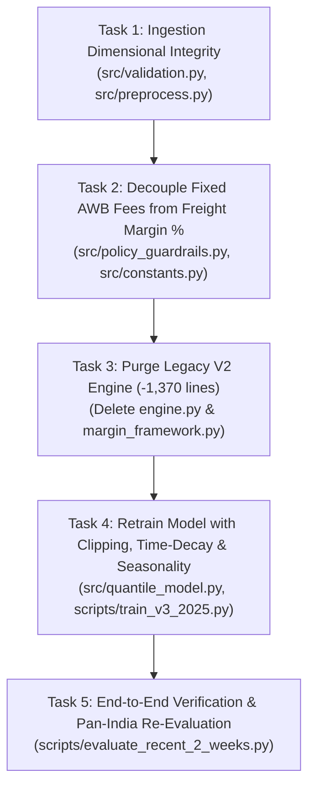

# Air Cargo Pricing Engine: Combined Remediation Implementation Plan

> **Goal:** Eliminate unrealistic 500%–870% margin spikes, decouple fixed AWB fees from freight percentages, enforce dimensional ingestion integrity, purge 1,370 lines of legacy dead code, and incorporate seasonality and time-decay weighting into model training.

---

## 1. Executive Summary & Root Cause Synthesis

The recent 2-week Pan-India benchmark revealed three interacting failure modes that distorted model recommendations:

```
[ERP Ingestion Bug]                 [Guardrail Math Flaw]                     [Model Training Drift]
Unit rate (₹311/kg) dumped    --->  Fixed ₹1,500 AWB fee divided by    --->  Trained on 2025 won deals (11.2% median)
into "Total Buy" column             tiny buy cost (₹174), forcing             containing 24 outliers up to 10,859%
(shipment buy = ₹311 vs ₹7,775)     mathematical 870% margin                  with no time decay or calendar features
```

### Combined Remediation Strategy
1. **Data Layer**: Enforce dimensional validation ($Total\_Buy \approx Unit\_Buy \times Weight$) across all ingestion pipelines.
2. **Guardrail Layer**: Decouple flat origin documentation fees (₹1,500 AWB + ₹850 handling) from base freight margin percentages. Freight margin models the freight tariff markup (2%–25%); fixed fees are itemized flat rupee charges.
3. **Architecture Layer**: Delete 1,370+ lines of dead legacy V2 engine code (`src/engine.py` and `src/margin_framework.py`).
4. **Data Science Layer**: Retrain quantile models with margin clipping at 45.0%, exponential time-decay sample weighting ($\lambda = 0.005/\text{day}$), and native calendar features (`Day_Of_Week`, `Month`).

---

## 2. Plan Architecture & Tasks



---

### Task 1: Data Ingestion & Validation Dimensional Integrity
* **Files:** `src/validation.py`, `src/preprocess.py`, `scripts/evaluate_recent_2_weeks.py`
* **Tests:** `tests/test_validation.py`
* **Changes:**
  1. Add `reconcile_freight_buy(total_buy, unit_buy, weight)` in `src/validation.py`:
     - If `abs(total_buy - unit_buy) < 1.0` and `weight > 1.0`: set `total_buy = unit_buy * weight`.
     - Validate that resulting `unit_rate = total_buy / weight` is within IATA commercial bounds (₹10/kg to ₹3,000/kg).
  2. Apply reconciliation in `scripts/evaluate_recent_2_weeks.py`.

---

### Task 2: Decouple Fixed AWB Fees from Freight Margin %
* **Files:** `src/policy_guardrails.py`, `src/constants.py`, `src/engine_v3.py`
* **Tests:** `tests/test_policy_guardrails.py`, `tests/test_guardrails.py`
* **Changes:**
  1. Update `compute_cost_floor_price` and `apply_commercial_guardrails`:
     - Base freight margin floor is calculated as a pure rate markup: `MIN_CANDIDATE_MARGIN` (1.0%) + `risk_buffer`.
     - Fixed documentation charges (`awb_fee_inr = 1500.0`, `ops_handling_fee_inr = 850.0`) are separated from the freight markup denominator.
     - `GuardrailResult` returns:
       - `final_margin_pct`: Freight tariff margin percentage (e.g. 2.5% to 25.0%, never 500%+).
       - `freight_sell_inr`: Base air freight sell amount.
       - `origin_fees_inr`: Flat origin AWB and handling fee line item.
       - `total_quoted_sell_inr`: `freight_sell_inr + origin_fees_inr`.
  2. Enforce commodity/client category ceilings so margins never blow out into hundreds of percent.

---

### Task 3: Purge Legacy V2 Engine Dead Code (-1,370 Lines)
* **Files:** Delete `src/engine.py` (720 lines) and `src/margin_framework.py` (650 lines).
* **Tests:** Migrate references in:
  - `tests/test_engine_determinism.py`
  - `tests/test_strategy_tiers.py`
  - `tests/test_model_unit_eval.py`
  - `tests/test_scenarios_t1_t15.py`
  - `tests/test_cohort_lookup.py`
  - `scripts/test_runner.py`
  to use `PricingEngineV3`.

---

### Task 4: Model Retraining (Outlier Clipping, Time-Decay & Seasonality)
* **Files:** `src/quantile_model.py`, `scripts/train_v3_2025.py`
* **Changes:**
  1. **Winsorization**: In `train_v3_2025.py`, clip `Margin_Percentage` at 45.0% before training. This eliminates the 24 extreme outliers up to 10,859% that corrupt quantile tree split points.
  2. **Exponential Time Decay**: Compute sample weights:
     $$w_i = \exp\left(-\lambda \cdot (t_{\max} - t_i)\right),\quad \lambda = 0.005/\text{day}$$
     Recent inquiries receive high weight, pulling median predictions closer to current market conditions (2%–5%) rather than early-2025 levels.
  3. **Calendar Features**: Add `Day_Of_Week` (0–6) and `Month` (1–12) to capture verified seasonality ($H = 44.22$ and $H = 19.27$).
  4. Retrain models to produce updated bundle `models/v3/quantile_models_pit_2025.joblib`.

---

### Task 5: End-to-End Pan-India Re-Evaluation & Verification
* **Files:** `scripts/evaluate_recent_2_weeks.py`
* **Verification:**
  1. Run `pytest tests/` (100% passing across all unit and integration suites).
  2. Re-run `evaluate_recent_2_weeks.py` on the 3,685 quotes.
  3. Verify that zero quotes have margins exceeding realistic caps, and model `Floor` / `Balanced` corridors cleanly bracket coordinator quotes.
